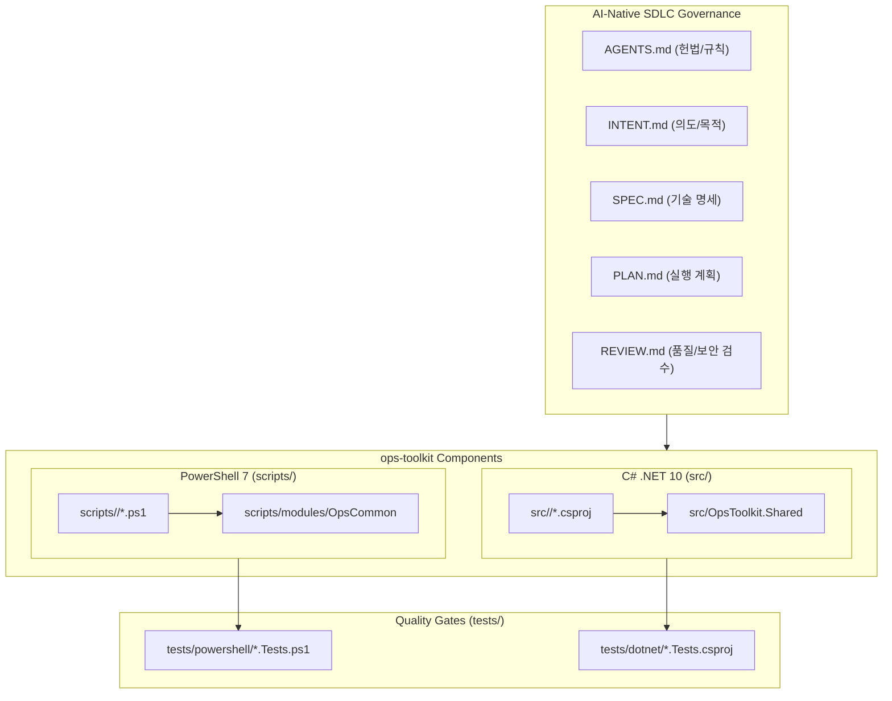

# SPEC.md — Technical Architecture & Specification

> **문서 역할**: `INTENT.md`에서 정의한 목적을 달성하기 위한 **구체적인 기술 명세, 폴더 규격, CLI/스크립트 인터페이스 계약(Contract)**을 정의합니다.

---

## 1. 시스템 및 런타임 사양

- **Target OS**: Windows 10 / 11, Windows Server 2019 / 2022 / 2025 (필요 시 Cross-platform 고려)
- **PowerShell Target**: PowerShell `7.4` 이상 (현재 개발 환경 `7.6.x`)
- **.NET Target**: `.NET 10.0` (`net10.0`), C# `latest` (C# 14)
- **인코딩 표준**: 모든 소스 코드 및 스크립트는 `UTF-8` (PowerShell 5.1 하위 호환이 어쩔 수 없이 필요한 경우에만 UTF-8 with BOM, 기본은 UTF-8)

---

## 2. 아키텍처 및 컴포넌트 구조



---

## 3. 컴포넌트별 상세 명세

### 3.1 PowerShell 7 스크립트 규격 (`scripts/`)

모든 `.ps1` 스크립트는 다음 표준 템플릿 계약을 준수해야 합니다:

```powershell
#Requires -Version 7.0
<#
.SYNOPSIS
    도구의 한 줄 요약 설명
.DESCRIPTION
    도구의 상세 동작 방식 및 주의사항 설명
.PARAMETER Target
    대상 서버 또는 경로
.EXAMPLE
    pwsh .\scripts\server\Invoke-SampleMaintenance.ps1 -Target "SRV01" -WhatIf
#>
[CmdletBinding(SupportsShouldProcess = $true, ConfirmImpact = 'Medium')]
param(
    [Parameter(Mandatory = $true, HelpMessage = "작업 대상 식별자")]
    [ValidateNotNullOrEmpty()]
    [string]$Target
)

Set-StrictMode -Version Latest
$ErrorActionPreference = 'Stop'

try {
    if ($PSCmdlet.ShouldProcess($Target, "Perform maintenance action")) {
        # 실제 작업 수행 및 구조화된 객체 반환
        [PSCustomObject]@{
            Timestamp = (Get-Date).ToString('o')
            Target    = $Target
            Status    = 'Success'
        }
    }
}
catch {
    Write-Error -ErrorRecord $_
    exit 1
}
```

### 3.2 C# (.NET 10) CLI 애플리케이션 규격 (`src/`)

1. **공통 빌드 속성 (`Directory.Build.props`)**:
   - `TargetFramework`: `net10.0`
   - `ImplicitUsings`: `enable`
   - `Nullable`: `enable`
   - `TreatWarningsAsErrors`: `true`
   - `EnforceCodeStyleInBuild`: `true`
2. **표준 CLI 옵션 계약**:
   - `--help` / `-h`: 사용법 및 예제 출력
   - `--version`: 빌드 버전 출력
   - `--dry-run`: (상태 변경 도구인 경우 필수) 실제 변경 없이 수행 예정 작업만 출력
   - `--verbose` / `-v`: 상세 진단 로그 출력
   - `--json`: 파이프라인 연동을 위한 JSON 포맷 출력 (선택/권장)
3. **에러 처리 및 종료 코드**:
   - 처리되지 않은 예외로 스택 트레이스가 그대로 노출되지 않도록 최상위 핸들러에서 표준 에러(`stderr`)로 메시지를 출력하고 종료 코드 `1`을 반환합니다.
   - `PosixSignalRegistration` 또는 `Console.CancelKeyPress`를 통해 `CancellationToken`을 연결하여 작업 중단 시 안전하게 리소스를 정리합니다.

---

## 4. 멀티 AI CLI 호환 명세

| 도구명 | 진입 파일 | 연동 방식 |
| :--- | :--- | :--- |
| **OpenAI Codex / 범용 Agent** | `AGENTS.md` | 루트 `AGENTS.md` 직접 로드 |
| **Claude Code** | `CLAUDE.md` | `@AGENTS.md`, `@INTENT.md`, `@SPEC.md`, `@PLAN.md`, `@REVIEW.md` 임포트 |
| **Gemini CLI / Antigravity** | `GEMINI.md` / `AGENTS.md` | 루트 `GEMINI.md` 및 `AGENTS.md` 로드 |
| **GitHub Copilot** | `.github/copilot-instructions.md` | 루트 SDLC 문서 참조 지침 포함 |
