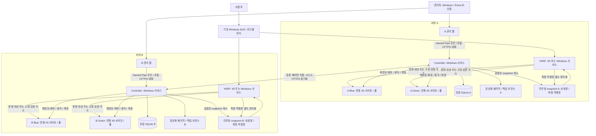
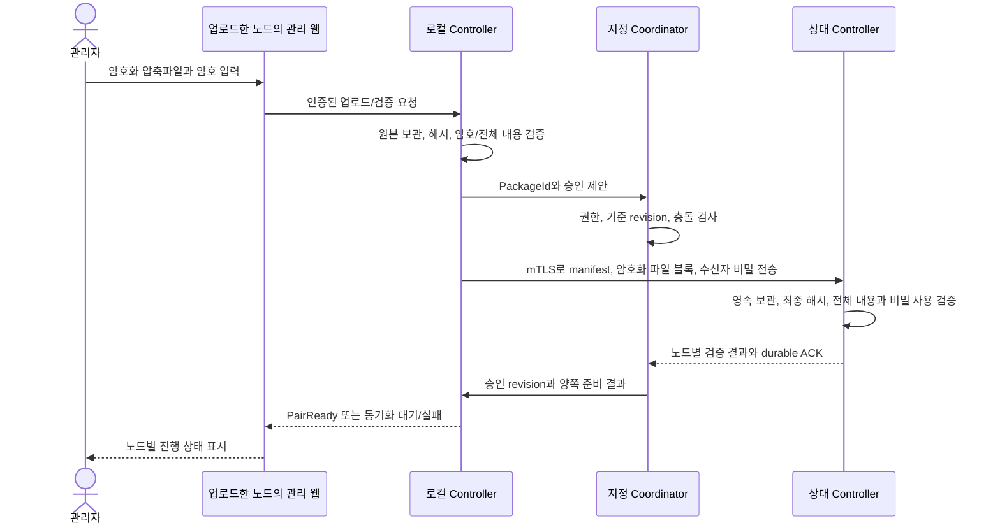

# IISDeploySlotManager — 아키텍처 설명

> 설계 설명 문서이며 실행 중인 제품의 구조를 검증한 보고서가 아니다. 상세 계약은 [SPEC.md](SPEC.md), 배경과 목적은 [BACKGROUND.md](BACKGROUND.md), 장애 복구 순서는 [RECOVERY.md](RECOVERY.md)를 기준으로 읽는다.

## 1. 전체 구조

사용자 요청을 처리하는 경로와 배포를 제어하는 경로를 분리한다. 사용자 요청은 기존 NLB/LB → 해당 노드 YARP → 운영 슬롯으로 흐른다. 관리자는 별도 관리 웹을 통해 Windows 제어 서비스에 작업을 요청한다. 제어 서비스와 관리 DB가 불가해도 Proxy는 마지막 적용 완료 라우팅으로 기존 서비스할 수 있게 한다.

그림의 Proxy→슬롯 화살표는 운영 대상 선택과 검증 주소의 고정 연결을 함께 표현한다. 운영 주소를 기본적으로 두 슬롯에 동시에 분산하는 뜻은 아니다. A/B는 둘 다 트래픽을 받는 노드이고 Blue/Green은 각 노드 내부의 배포 슬롯이다. 두 축을 혼동하지 않는다. 단독 모드는 노드 하나만 사용하고 페어 승인·파일 복제를 요구하지 않는다.

라우팅 snapshot 상자는 두 역할의 파일을 묶어 표현한다. Controller가 게시하는 요청본은 Proxy에 읽기 전용이고, Proxy가 별도 경로에 보관하는 최종 적용본은 실제 적용이 확인된 구성이다. 요청 파일의 존재를 적용 완료로 간주하거나 두 파일의 쓰기 권한을 혼용하지 않는다.

## 2. 구성 요소와 권한 경계

| 구성 요소 | 담당하는 일 | 직접 접근/변경 경계 |
|---|---|---|
| Admin 웹 | 입력·권한별 화면, 계획·점검·작업·이력 조회 | Controller에 제한된 명령 요청; SQLite/IIS/프로세스 직접 변경 금지 |
| Controller 서비스 | 배포·중지·강제 종료·암호화·예약·동기화·복구 조정 | 등록된 솔루션/사이트/풀/경로와 필요한 키; 매 작업 재검증 |
| Proxy | 사용자 요청 전달, 슬롯 검증 주소, 실제 적용 상태 제공 | 검증된 라우팅 snapshot 읽기; 관리 DB나 특권 배포 권한 없음 |
| Blue/Green | 업무 웹 실행 | 각각 전용 App Pool·경로·계정; 앱의 기존 인증 유지 |
| SQLite | 설정·작업·예약·감사·동기화 저널·암호문 | 로컬 Controller만 DB 접근; 원격 파일 공유/DB 파일 병합 없음 |
| 파일 보관소 | 불변 암호화 배포파일과 검증된 압축 백업 | 웹 루트 밖, ACL·보존 정책·해시 검증 |
| 확장 모듈 | 솔루션별 설정 변환·암호화·점검 | 등록한 입력/출력 계약·계정·제한 시간; 임의 셸 실행 인터페이스 아님 |
| Recovery 실행기 | Controller/DB 불가 시 로컬 압축 백업 복원 | OS 관리자·서비스 실행 차단·복구 잠금·독립 저널 조건 |

웹에 관리자 권한을 부여해서 프로세스를 종료하는 구조를 피하고, 설치 단계에서 전용 서비스 계정에 필요한 권한을 위임한다. 권한이 충분해도 대상 소유권·현재 운영 슬롯·작업 잠금 검사는 생략하지 않는다. 기한 후 강제 종료도 확인된 전용 풀의 프로세스만 대상으로 한다.

## 3. 호스팅과 인증서

YARP는 같은 프록시 코드로 IIS 호스팅과 Windows 서비스 실행을 지원하는 설계다. IIS 모드는 사이트 HTTPS 바인딩, 독립 서비스 모드는 해당 서버 호스트의 HTTPS 설정으로 사용자용 인증서를 관리한다. 두 모드가 한 노드의 같은 운영 endpoint를 동시에 점유하지 않는다. 전환 시 포트·인증서·개인 키 권한·프로세스 인계를 검증하고 실패하면 이전 모드 복구를 시도한다.

같은 서버의 Proxy→슬롯은 루프백 HTTP를 기본 설계로 하며 백엔드 직접 외부 접근을 제한한다. 운영 주소의 인증서는 슬롯 배포 때 옮기지 않는다. 관리자 HTTPS, 노드 간 mTLS, 패키지/백업 비밀 보호 키는 역할이 다르므로 하나의 인증서·키가 모든 역할을 겸한다고 가정하지 않는다. 실제 인증서·키 조합과 교체 절차는 설치 정책으로 정한다.

## 4. 웹과 서비스의 명령 전달

웹은 사용자를 Windows 또는 Entra ID로 인증하고 조회·배포·전환·복구·시스템 설정 권한을 적용한다. Controller는 인증된 웹 서비스 주체와 전달된 사용자 문맥을 확인하고 대상/작업 권한을 다시 검사한다. 브라우저의 사용자 이름·역할 헤더를 그대로 신뢰하지 않는다.

Named Pipe를 우선 사용하고 로컬 ACL과 서버 소유 주체를 확인한다. IPC 연결 불가일 때만 인증된 루프백 HTTPS로 대체한다. 인증/권한 거부는 우회 사유가 아니다. 양쪽 통신 경로는 동일한 handler와 RequestId·주체·명령·대상·인자 fingerprint를 사용한다. 요청 전송 후 응답이 사라져도 동일 ID 상태를 조회하고 새 작업을 중복 생성하지 않는다.

긴 작업은 서비스가 영속 접수한 뒤 작업 ID를 반환한다. 브라우저나 웹 App Pool이 종료돼도 서비스가 단계와 결과를 기록한다. 접수 성공, 상대 동기화 완료, 배포 완료, 운영 전환 완료는 각각 다른 상태다.

## 5. 페어링과 노드 통신

노드는 최초 설치에서 Unpaired다. 양쪽 인증된 관리자 경로에서 공개 페어링 정보와 인증서 지문을 등록하고, 별도 확인 경로로 상대 지문을 대조한다. 원격 bootstrap을 위해 무인증 API를 여는 방식은 사용하지 않는다. 개인 키와 평문 암호는 페어링 파일에 포함하지 않는다.

이후 Windows 서비스끼리 직접 mTLS HTTPS로 연결해 서버/클라이언트 인증서와 키 소유를 확인한다. TLS 검증 뒤에도 등록된 PairId·NodeId·키·멤버십·현재 권한을 검사한다. 같은 CA가 발급한 다른 서버의 인증서나 허용 IP만으로는 통과하지 않는다.

전용 프로토콜은 HTTPS 위의 버전 있는 명령·변경 이벤트·파일 블록·ACK 규약이다. 데이터와 파일에 같은 인증 모델을 쓰지만 명령 종류·솔루션 범위·메시지 크기·전송 제한을 각각 인가한다. 파일 수신이나 snapshot 수신이 원격 실행 권한을 뜻하지 않는다. 인증서 교체·폐기 시 기존 세션과 미소비 작업 허가도 검사하며 인증 실패를 평문 통신으로 대체하지 않는다.

## 6. 한쪽 업로드와 양쪽 준비 완료

다음 그림은 A를 조정 노드로 등록한 예다. B에서 업로드해도 명령 승인 순서는 A가 관리하고 원본 업로드 ID와 패키지 해시는 유지한다.

그림의 Local과 Leader는 논리 역할이며 업로드가 조정 노드에서 이루어지면 같은 서비스 안의 호출이다. 파일 전송은 암호화 원본을 사용하고 중단 시 누락 블록부터 이어받는다. 수신 중 압축을 풀거나 앱을 기동하지 않는다. 암호는 DB 암호문으로 보관하고 상대 공개 키를 이용한 수신자 전용 보호로 전달한다. 개인 키나 한 컴퓨터에 묶인 암호문을 그대로 복제해 다른 서버에서 쓸 수 있다고 가정하지 않는다.

LocalVerified는 한 노드의 검증 완료다. PairReady는 양쪽 파일·전체 내용·수신 비밀 사용을 확인한 상태다. 상대 서버의 용량·인증·연결 문제로 복제가 실패하면 사용자가 다른 웹에 다시 업로드하게 하지 않고 미완료 상태와 허용된 재시도를 제공한다. 자동 복제와 자동 운영 전환은 별개다.

## 7. SQLite 동기화와 실행 조정

별도 DB 서버 없이 노드마다 SQLite를 두므로 로컬 DB 트랜잭션이 두 서버의 전역 잠금이 될 수 없다. 이를 감추지 않고 공유 변경 명령은 지정 Coordinator 하나가 직렬화한다. 사용자 트래픽 Active–Active와 배포 조정 단일 책임은 다른 개념이다.

로컬 변경과 outbox 이벤트를 같은 트랜잭션에 저장하고, 상대는 inbox 중복 검사·내용 반영·cursor를 영속 저장한 뒤 ACK를 돌려준다. 전송은 재시도될 수 있으므로 ID·sequence·revision으로 중복과 순서를 확인한다. 같은 설정의 동시 수정은 충돌로 표시하고 서버 시각이 더 늦다는 이유로 덮어쓰지 않는다.

노드 관측과 실행 결과는 해당 노드가 원본이다. 소스 서버의 PID·경로·개인 키·실제 라우팅을 다른 서버 상태로 복사하지 않는다. 삭제는 tombstone과 보존 참조를 관리하며 오래된 노드의 재접속으로 삭제 항목을 되살리지 않는다. 신규/장기 오프라인 노드는 논리 snapshot과 후속 변경을 받아 따라잡는다.

상대 확인이 없으면 기존 서비스는 유지하되 신규 페어 변경을 보류한다. 장애 인계는 구노드의 실제 변경 실행을 차단한 뒤 복구 전용 DegradedMaintenance로 진행한다. 두 노드만으로 통신 단절과 장애를 구분했다고 주장하거나 자동 승격하지 않는다.

## 8. 배포·검증·전환

1. 패키지와 설정 계획을 검증하고 현재 운영 릴리스의 복구 백업을 확보한다.
2. 덮어쓸 대기 슬롯의 운영/검증 요청을 차단하고 전용 사이트/풀을 중지한다. 기한 후에도 남으면 소유권·권한을 확인해 한정 종료한다.
3. 대상의 변경 전 압축 백업을 생성·전체 검증하고, 설정 변환·파일 배치·필요한 설정 암호화를 수행한다.
4. Standby 모드에서 배치·DB 변경·메일 등 부작용 억제 계약을 확인한 뒤 기동·워밍업한다.
5. 서버·슬롯별 검증 주소에서 자동 핵심 기능 점검과 해당 revision의 수동 확인을 수행한다.
6. 두 노드의 대기 슬롯 준비 후 A를 전환한다. RequestedRevision과 실제 AppliedRevision·InstanceId, Proxy 경유 릴리스를 대조한다.
7. 관찰 시간·필수 점검·오류/지연·표본 기준을 통과한 뒤 B를 전환한다. 실패/판정 불가는 다음 전환을 보류한다.

DB 저장이나 snapshot 게시만으로 전환 성공을 기록하지 않는다. YARP 적용이 거부되거나 응답이 불명확하면 이전 슬롯에 트래픽이 남을 수 있으므로 이전 슬롯 중지·덮어쓰기를 금지한다. 일반 LB의 HTTP readiness와 달리 Windows NLB는 별도 앱 감시·제외 연동을 확인해야 한다.

## 9. 백업과 롤백

CurrentServingRecovery는 배포 전 운영 릴리스로 돌아갈 자료이고 TargetBeforeOverwrite는 덮어쓸 대상 슬롯의 기존 상태다. 두 슬롯의 버전이 다르면 별도 백업이 필요하다. 백업 전체를 읽고 파일 해시·manifest·암호/키 접근을 검증하기 전 파괴적 변경을 시작하지 않는다.

정식 롤백은 백업 압축파일을 격리 경로에서 검증해 대상 앱·지정 설정의 파일 집합을 복원하고 기동·점검·라우팅 적용·관찰을 확인하는 작업이다. 새 버전에서 추가된 관리 DLL은 정리 목록으로 제거하고, Preserve·사용자 업로드·타 솔루션 파일은 명시적 범위 밖에서 변경하지 않는다. 복원 직전 상태도 새 백업으로 보존한다.

관리 웹만 불가하면 CLI가 Controller에 요청한다. 서비스나 관리 DB까지 불가하면 로컬 Recovery 실행기가 서비스 재시작 억제·전역 잠금·RecoveryHold·독립 저널을 사용한다. 활성 사이트 직접 덮어쓰기는 대상 트래픽을 제외하고 중지한 명시적 긴급 복원에 한한다. 이후 Controller가 실제 상태와 저널을 대조하기 전 예약·구명령을 재개하지 않는다.

## 10. 강제 동기화

증분 동기화로 해결하지 못한 공유 데이터 불일치는 관리자가 기준 서버·대상·범위를 지정해 복구한다. 양쪽 DB 백업과 논리 snapshot을 보존하고 잃게 되는 대상 변경을 diff로 표시한다. 선택한 공유 데이터만 대상 트랜잭션으로 복구하고 파일/비밀을 재검증한 뒤 양쪽 확인으로 Synced를 기록한다.

노드 식별·로컬 경로·개인 키·실제 PID/라우팅·대상 감사 기록은 일괄 교체하지 않는다. 구명령 replay를 격리하고 복사된 예약은 보류한다. 동기화는 실제 IIS/프로세스/업무 파일 변경을 자동 실행하지 않으며 적용은 별도 계획이다. 상대가 단절되면 강제 완료 처리하지 않는다. 강제 동기화도 동일한 mTLS·등록 노드 인가를 통과해야 한다.

## 11. 주요 설계 선택과 이유

| 선택 | 이유 | 함께 감수하는 제약 |
|---|---|---|
| YARP를 고정 진입점으로 사용 | 슬롯 전환 때 사용자 주소·TLS 바인딩을 유지하고 전달 대상을 제어 | 프록시 자체 가용성·업데이트는 별도 검증 |
| 일반 권한 웹 + Windows 제어 서비스 | 브라우저 요청 경계와 높은 시스템 권한을 분리 | IPC/HTTP 인증·최종 권한 검사가 필요 |
| 노드별 SQLite | 별도 DB 서버 설치 없이 운영 상태 보관 | 동기화·충돌·복구 규약을 별도로 구현/검증 |
| 지정 단일 배포 조정 노드 | 양쪽 관리 요청과 예약의 경쟁을 직렬화 | 상대/조정 경로 장애 시 신규 페어 변경 보류 |
| mTLS HTTPS + 전용 메시지 규약 | 표준 TLS 위에서 등록 노드만 데이터/파일 교환 | 최초 신뢰 등록·키 교체/폐기 절차 필요 |
| 배포 전 압축 백업 | 버전 파일과 설정의 실제 복구 원본 확보 | 공간·키·일관성·복원 훈련과 보존 비용 필요 |
| 스크립트/모듈 확장 | 솔루션마다 다른 점검·설정 암호화 지원 | 모듈 신뢰·권한·출력·기한을 검증해야 함 |

## 12. 상세 명세와 검증 상태

| 이 설명의 영역 | 상세 계약 |
|---|---|
| 구성·초기 설정·관리 인증 | [SPEC.md](SPEC.md) 1~3절 |
| 영속 작업·Proxy 적용·중지·설정·점검 | SPEC 4~7절 |
| 백업 롤백·예약·호스팅·암호화 패키지 | SPEC 8~11절 |
| HA·SQLite 동기화·웹/서비스 통신 | SPEC 12~14절 |
| 백업·긴급 복구·강제 동기화·페어링 | SPEC 15~17절, [RECOVERY.md](RECOVERY.md) |

압축 형식/라이브러리, SQLite provider, 실제 점검·변환·암호화 모듈과 환경별 인증/계정·관찰 임계값은 구현 전 확정할 항목이다. 도표는 설계 흐름이며 구현 상태나 성능·가용성 보장을 나타내지 않는다. 단계와 시험 계획은 [PLAN.md](PLAN.md), 실제 검수 상태는 [REVIEW.md](REVIEW.md)에서 확인한다.
